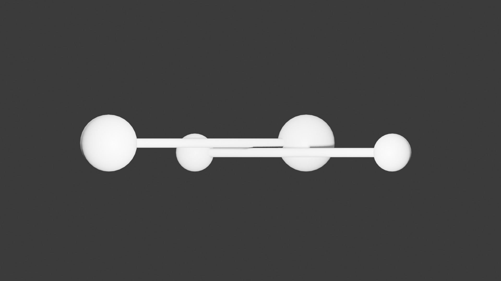
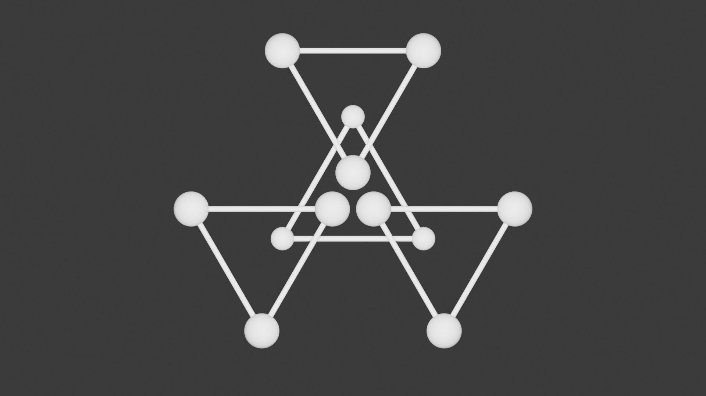

# Shape
## Shape Conditions for $T_1$ and $T_2$

This document defines geometric constraints and decision conditions for $T_1$ and $T_2$.

### 1. General constraints

#### 1.1 Prepare two structure types in which the sides of an equilateral triangle have diameter, and each vertex has a sphere centered on it.
#### 1.2 Of the two structure types, one has larger vertex spheres and the other has smaller vertex spheres.  

#### 1.3 When the two structure types are placed on the same plane, sides (with finite diameter or thickness) must not interfere along the height direction when overlaid.  

#### 1.4 In the projection direction, three larger vertex spheres must fit within the inner region of the structure with smaller vertex spheres.  

### 2. Definitions

| Symbol    | Description                                                                                   |
| --------- | --------------------------------------------------------------------------------------------- |
| $VS$      | A sphere centered at each vertex $(Vertex Sphere)$                                            |
| $E$       | An edge connecting the centers of the $VS$                                                    |
| $S_1$     | A $VS$ with diameter $d_1$ (larger type)                                                      |
| $S_2$     | A $VS$ with diameter $d_2$ (smaller type)                                                     |
| $T_1$     | A type-1 structural equilateral triangle obtained by joining the centers of the $VS$ of $S_1$ |
| $T_2$     | A type-2 structural equilateral triangle obtained by joining the centers of the $VS$ of $S_2$ |
| $d_1$     | The diameter of $S_1$                                                                         |
| $d_2$     | The diameter of $S_2$                                                                         |
| $d_3$     | The diameter of $E$                                                                           |
| $a$       | The side length of the reference equilateral triangle                                         |
| $a'$      | The side length of the equilateral triangle offset inward by $d_3/2$                          |
| $T$       | The reference equilateral triangle with side length $a$ for $T_1$ and $T_2$                   |
| $T_{in}$  | The inward-offset equilateral triangle with side length $a'$                                  |
| $r_{in}$  | The inradius of $T$                                                                           |
| $r'_{in}$ | The inradius of $T_{in}$                                                                      |

### 3. Decision conditions

#### 3.1 Conditions for determining the diameters of $S_1$, $S_2$, and $E$

$$d_1 > d_2 > d_3 \tag{1}$$

$$\frac{d_1}{2} - \frac{d_3}{2} > \frac{d_2}{2} + \frac{d_3}{2} \tag{2}$$

 - From condition $(1)$:

$$d_2 > d_3$$

 - By rearranging condition $(2)$:

$$\frac{d_1 - d_3}{2} > \frac{d_2 + d_3}{2}$$

$$d_1 - d_3 > d_2 + d_3$$

$$d_1 > d_2 + 2d_3$$

 - Therefore, the two conditions can be summarized as follows:

$$\boxed{d_1 > d_2 + 2d_3 \quad \land \quad d_2 > d_3}$$

#### 3.2 Conditions for determining side length

Determine the inner triangle by accounting for side diameter

 - Inradius of the reference triangle:

$$r_{in} = \frac{\sqrt{3}}{6}a$$

 - Inradius after the offset:

$$r'_{in} = \frac{\sqrt{3}}{6}a - \frac{d_3}{2}$$

 - Side length after the offset:

$$\boxed{a' = a - \sqrt{3}d_3}$$

Ensure that at least three projections of $S_1$ (circles with diameter $d_1$) can be placed inside the inner triangle

 - If a circle with diameter $d_1$ is tangent to the two sides meeting at a vertex of $T_{in}$, the distance from that vertex to the circle center is:

$$
\boxed{\frac{d_1/2}{\sin 30^\circ}\tag{3}=\frac{d_1/2}{1/2}=d_1}
$$

 - Distance between the centers of adjacent circles:

$$\boxed{a'\ge d_1(1+\sqrt{3})\tag{4}}$$

 - Non-interference with $S_2$ at a vertex of $T$:

#### 3.3 Appendix

 - The distance from a vertex of $T$ to the corresponding vertex of $T_{in}$ is:

$$\frac{d_3/2}{\sin 30^\circ}=d_3$$

 - Therefore, the distance between the center of $S_2$ at a vertex of $T$ and the center of a circle of diameter $d_1$ tangent to the two sides meeting at the corresponding vertex of $T_{in}$ is:

$$d_3 + d_1$$

 - For non-interference, it is sufficient that this distance be greater than the sum of the radii:

$$d_3 + d_1 > \frac{d_2}{2} + \frac{d_1}{2}$$

 - By rearranging:

$$d_1 + 2d_3 > d_2$$

 - This is guaranteed by condition $(1)$ and condition $(2)$, since:

$$d_1 > d_2 + 2d_3$$
