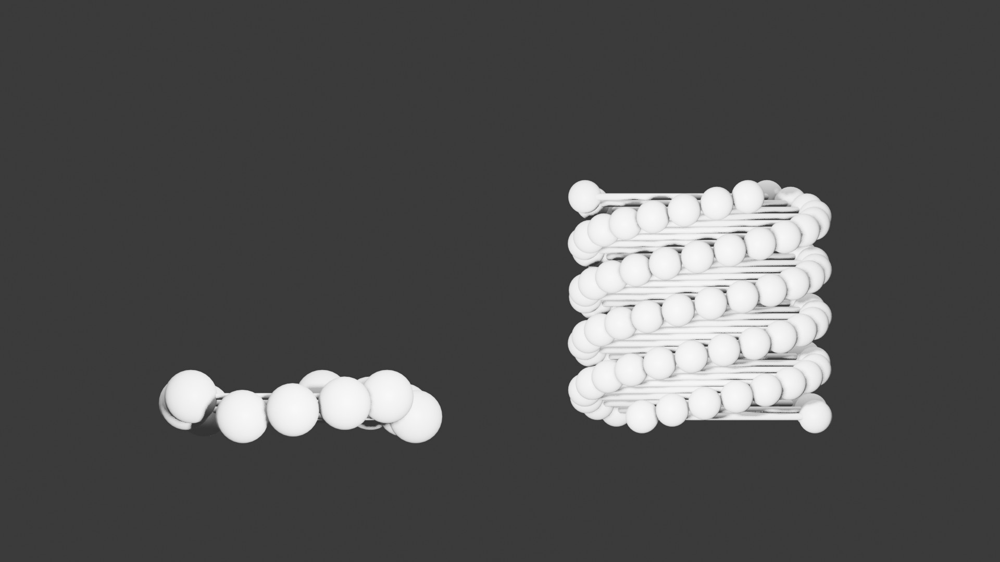
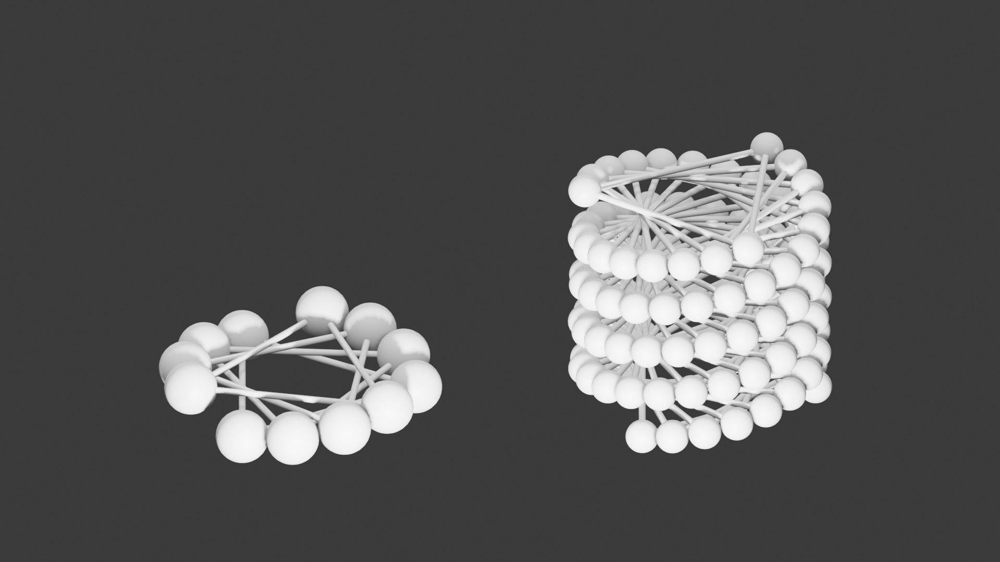
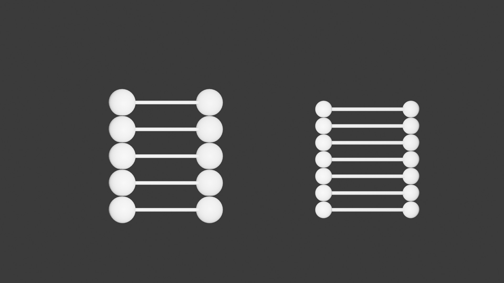
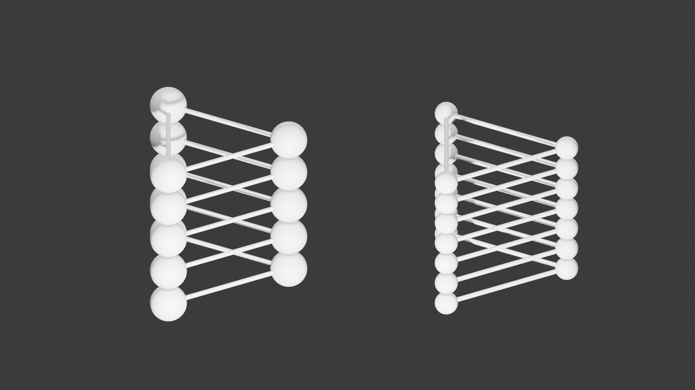
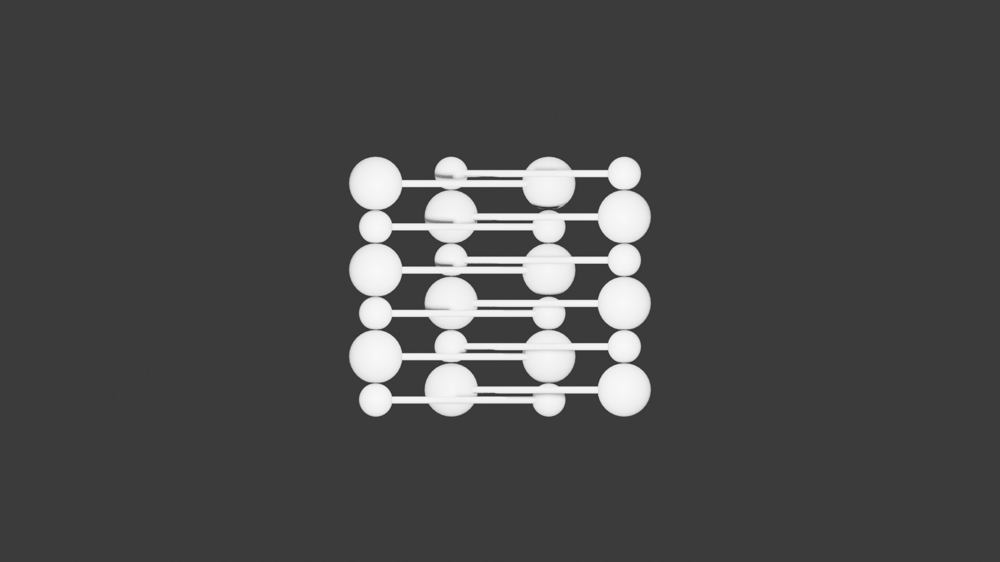
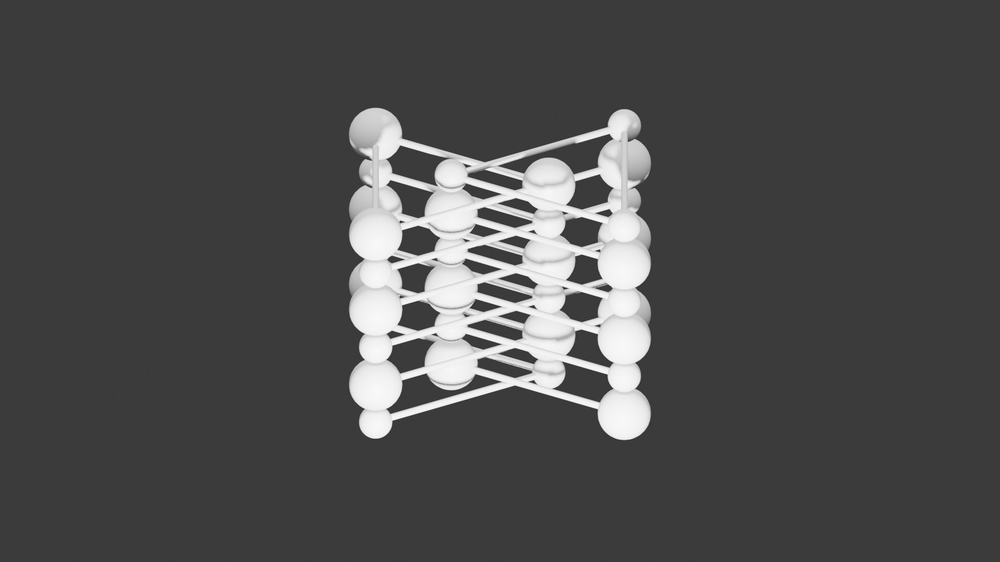
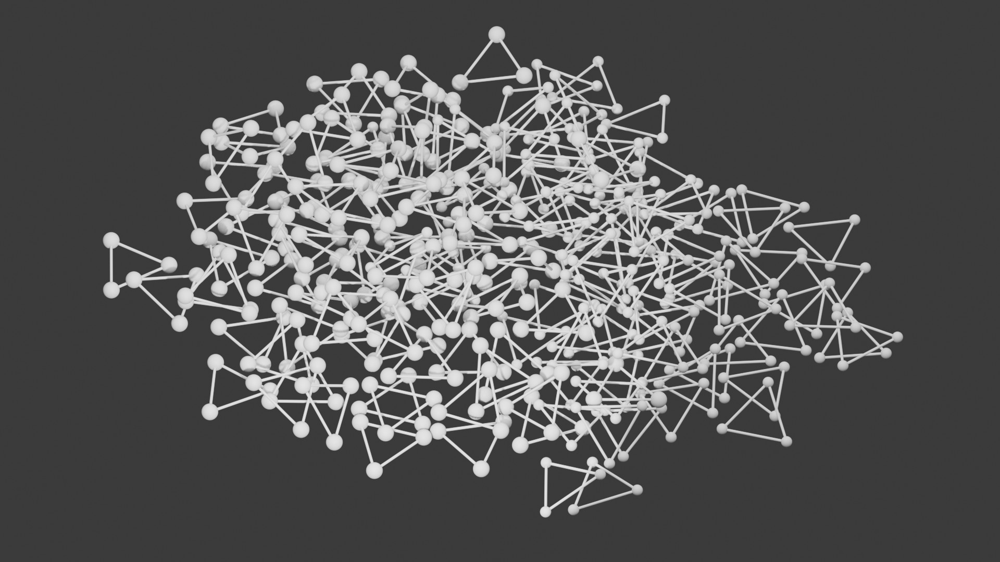

# Stack
## Stacking of $T_1$ and $T_2$

This document describes a simple stacking example for $T_1$ and $T_2$.

### 1. Helical

When stacking in a helical manner, the centers of the stacked structures are aligned, and the vertex spheres are layered so that they do not overlap one another. In other words, they are stacked so that the edges contact each other.

At this time, the stacked vertex spheres are arranged so that neighboring vertex spheres are adjacent. Repeating this process results in the vertex spheres being stacked in a helical pattern.

Even if the structures are aligned with $T_1$ and $T_2$, it is also reasonable to mix them and stack them in a helical pattern.
  
  

### 2. Vertical

The same vertex-sphere structure is stacked vertically.
When stacking, each structure is arranged so that the center of the structure and the center of its vertex sphere coincide.
  
  

### 3. Async

Building on the idea of the vertical stacking method, the structures are stacked alternately as $T_1$ and $T_2$ when placed.

At the same time, another system of stacked structures is considered using the same rule.
This second system begins from a different initial structure than the first one.

When the two systems are denoted as $A$ and $B$, the initial structures of each system are placed according to the rules defined in [placement.md](../placement/placement.md).

By stacking them alternately on top of one another, the edges can be arranged without interfering with each other.
  
  

### 4. Messy

We arrange them freely.
  
